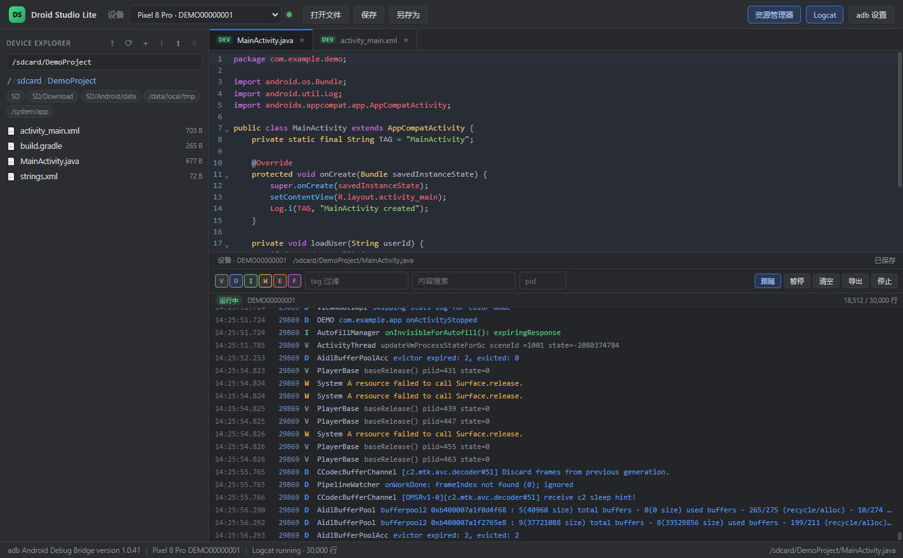
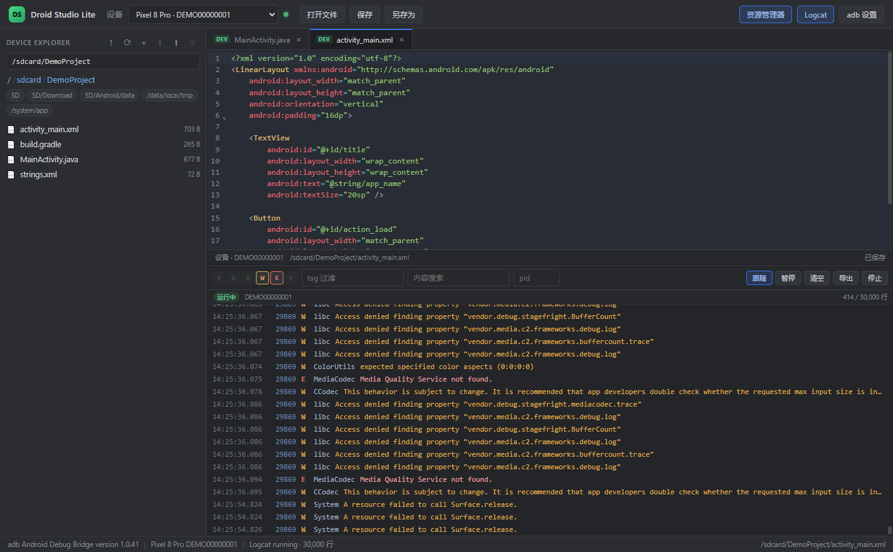
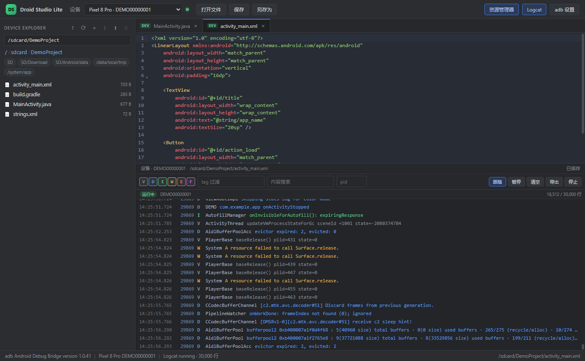

# Droid Studio Lite

English | [简体中文](README.md)

A lightweight Android companion that keeps only the three things you actually use during everyday debugging: **Logcat**, **Device Explorer**, and a **text editor**.

No Gradle startup, no project indexing. Open it, read logs, browse device files, fix a few lines.



## Features

### Logcat

- Live streaming log with level (V/D/I/W/E/F), tag, keyword and pid filters
- Pause / resume, follow tail, clear device log, export to txt
- Click a row to select it, `Shift`-click for a range, then `Ctrl+C` or right-click to copy rows, message, tag, or selected text
- Automatic reconnect after adb drops; first screen loads the last ~4,000 lines, UI keeps up to 30,000
- Virtualized list — tens of thousands of rows stay smooth



### Device Explorer

- Browse device directories (starts at `/sdcard`) with path input, breadcrumbs and parent navigation
- Create folder, upload, download to local disk, delete (with confirmation)
- Double-click a text file to open it in the editor
- Permission-denied directories produce a clear message instead of failing silently

### Text editor

- CodeMirror 6: line numbers, syntax highlighting, search & replace, line wrapping, bracket matching
- Supports JS / TS / JSX / JSON / XML / HTML / Java / Kotlin / Gradle
- Multiple tabs; local files and device files share one workspace
- Device saves use `pull → edit → push` and preserve the original permission bits



## Getting started

### Run the binary

1. Install `adb` (Android SDK Platform-Tools)
2. Enable USB debugging on the phone and authorize this machine
3. Double-click `DroidStudioLite-0.1.0.exe`

The portable build unpacks to a temp folder on first launch, so it takes a few extra seconds.

### Run from source

```bash
npm install
npm run dev
```

This starts both the Vite dev server and the Electron window.

### Build

```bash
npm run dist
```

Outputs a single portable executable at `release/DroidStudioLite-<version>.exe`.

If Electron or nsis downloads are slow, set the mirrors first:

```powershell
$env:ELECTRON_MIRROR='https://npmmirror.com/mirrors/electron/'
$env:ELECTRON_BUILDER_BINARIES_MIRROR='https://npmmirror.com/mirrors/electron-builder-binaries/'
```

## Shortcuts

| Shortcut | Action |
| --- | --- |
| `Ctrl+S` | Save current file |
| `Ctrl+Shift+S` | Save as (converts to a local file) |
| `Ctrl+W` | Close current tab |
| `Ctrl+C` | Copy selected log rows or selected text (when the log panel has focus) |

## How adb is located

1. Manually configured path (toolbar → “adb 设置”)
2. `ANDROID_HOME` / `ANDROID_SDK_ROOT` / `ANDROID_SDK_HOME`
3. System `PATH`
4. `%LOCALAPPDATA%\Android\Sdk` and common install locations

## Requirements

- Windows 10 / 11 (the code is cross-platform, but only Windows has been verified and packaged)
- A working `adb`
- USB debugging enabled on the device

## Known limitations

- On non-rooted devices, other apps' private directories under `/data/data` cannot be browsed — that is an Android permission model limit.
- Device file writes only work where the shell user has permission (e.g. `/sdcard`, `/data/local/tmp`).
- The editor rejects files larger than 8 MB and binary files.
- Logcat keeps at most 30,000 rows in the UI; use Export for anything older.
- The portable exe is unsigned, so SmartScreen may warn on first launch.

## Tech stack

Electron 33 · React 18 · TypeScript · Vite · CodeMirror 6 · esbuild

## About the screenshots

Screenshots in this document were captured with the built-in demo mode (`?demo=1`): device serial, model, third-party package names, private IPs and product-specific log lines are replaced or hidden. No real device or project data is included.

## License

[MIT](LICENSE)
