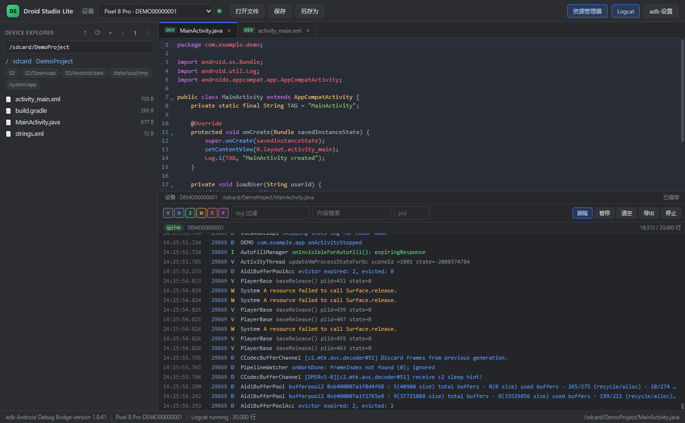
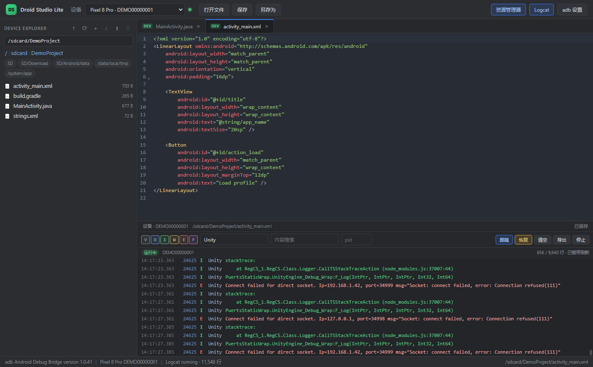
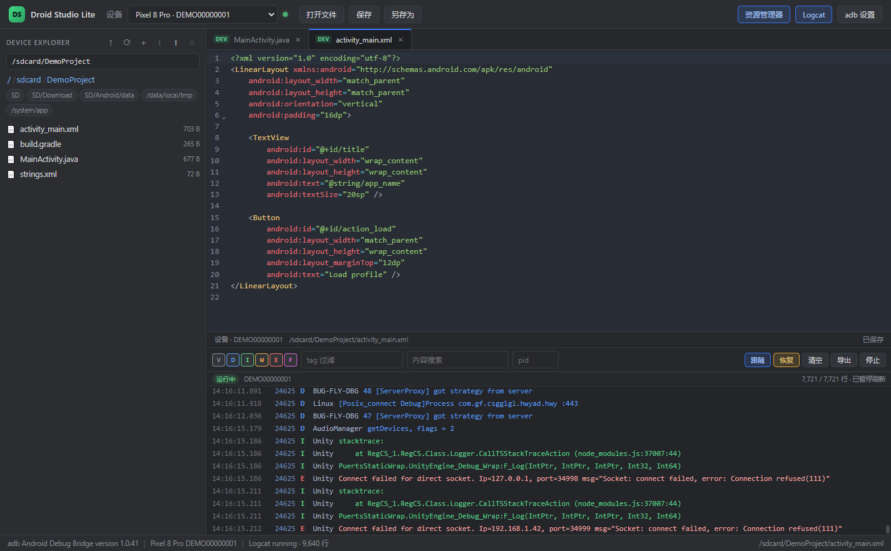

# Droid Studio Lite

官网: [https://suboy1219.github.io/suboy](https://suboy1219.github.io/suboy)

[English](README.en.md) | 简体中文

一个轻量的 Android 开发辅助工具，只保留日常调试里最常用的三件事：**Logcat**、**Device Explorer**、**文本编辑器**。

不启动 Gradle，不加载项目索引，打开就能看日志、翻设备文件、改几行代码。



## 功能

### Logcat

- 实时流式日志，支持级别（V/D/I/W/E/F）、tag、关键字、pid 过滤
- 暂停 / 恢复、自动跟随最新、清空设备日志、导出为 txt
- 点击选中行、`Shift` 连选；`Ctrl+C` 或右键菜单复制整行、消息、tag、选中文本
- 断线自动重连，首屏只取最近约 4000 行，界面最多保留 3 万行
- 虚拟滚动，几万行也不卡



### Device Explorer

- 浏览设备目录，默认 `/sdcard`，支持路径直达、面包屑、上级目录
- 新建文件夹、上传、下载到本地、删除（二次确认）
- 双击文本文件直接在编辑器中打开
- 无权限目录会给出明确提示，而不是静默失败

### 文本编辑器

- CodeMirror 6：行号、语法高亮、查找替换、自动换行、括号匹配
- 支持 JS / TS / JSX / JSON / XML / HTML / Java / Kotlin / Gradle
- 多标签，本地文件与设备文件共用一个工作区
- 设备文件保存走 `pull → 编辑 → push`，并保留原文件权限位



## 快速开始

### 直接运行

1. 确保本机已安装 `adb`（Android SDK Platform-Tools）
2. 手机开启「USB 调试」并授权本机
3. 双击 `DroidStudioLite-0.1.1.exe`

首次启动会解压到临时目录，比安装版稍慢几秒，之后正常。

### 从源码运行

```bash
npm install
npm run dev
```

`npm run dev` 会同时启动 Vite 开发服务器和 Electron 窗口。

### 打包

```bash
npm run dist
```

产物为单文件免安装版 `release/DroidStudioLite-<version>.exe`。

如果 Electron / nsis 下载缓慢，可先设置镜像：

```powershell
$env:ELECTRON_MIRROR='https://npmmirror.com/mirrors/electron/'
$env:ELECTRON_BUILDER_BINARIES_MIRROR='https://npmmirror.com/mirrors/electron-builder-binaries/'
```

## 快捷键

| 快捷键 | 作用 |
| --- | --- |
| `Ctrl+S` | 保存当前文件 |
| `Ctrl+Shift+S` | 另存为（转为本地文件） |
| `Ctrl+W` | 关闭当前标签 |
| `Ctrl+C` | 复制日志选中行或选中文本（焦点在日志区时） |

## adb 查找顺序

1. 应用内手动指定（工具栏「adb 设置」）
2. `ANDROID_HOME` / `ANDROID_SDK_ROOT` / `ANDROID_SDK_HOME`
3. 系统 `PATH`
4. `%LOCALAPPDATA%\Android\Sdk` 及常见安装目录

## 环境要求

- Windows 10 / 11（代码本身跨平台，但目前只在 Windows 上验证与打包）
- 本机可用的 `adb`
- 设备已开启 USB 调试

## 已知限制

- 非 root 设备无法浏览 `/data/data` 下其他应用的私有目录，这是 Android 权限模型限制。
- 设备文件写入只对 shell 用户有权限的位置生效（如 `/sdcard`、`/data/local/tmp`）。
- 编辑器上限 8 MB，二进制文件会被拒绝打开。
- Logcat 界面最多保留 3 万行，更早的日志需通过「导出」保存。
- 便携版 exe 未做代码签名，首次运行可能出现 SmartScreen 提示。

## 技术栈

Electron 33 · React 18 · TypeScript · Vite · CodeMirror 6 · esbuild

## 关于截图

文档中的截图由应用内演示模式（URL 参数 `?demo=1`）生成：设备序列号、型号、第三方包名、内网 IP 与产品相关日志均已替换或隐藏，不包含真实设备与项目信息。

## License

[MIT](LICENSE)

## 检测更新

在窗口中选择 **帮助 → 检测更新**。程序会比较当前版本和本项目 GitHub 最新正式发布版；发现新版后可选择打开发布页下载。无正式发布版或网络失败时会显示提示。
